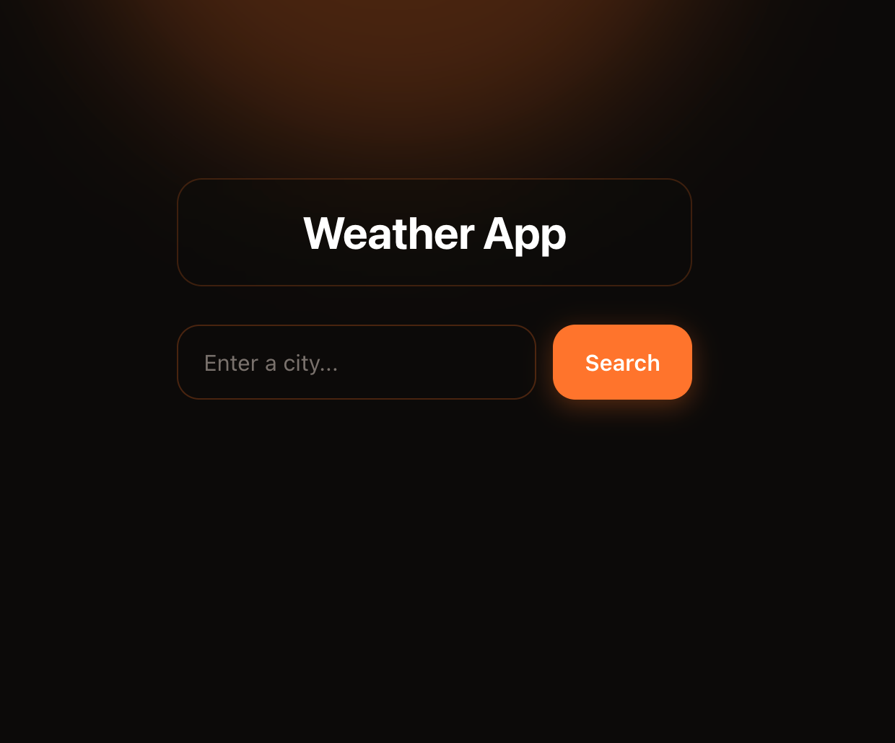
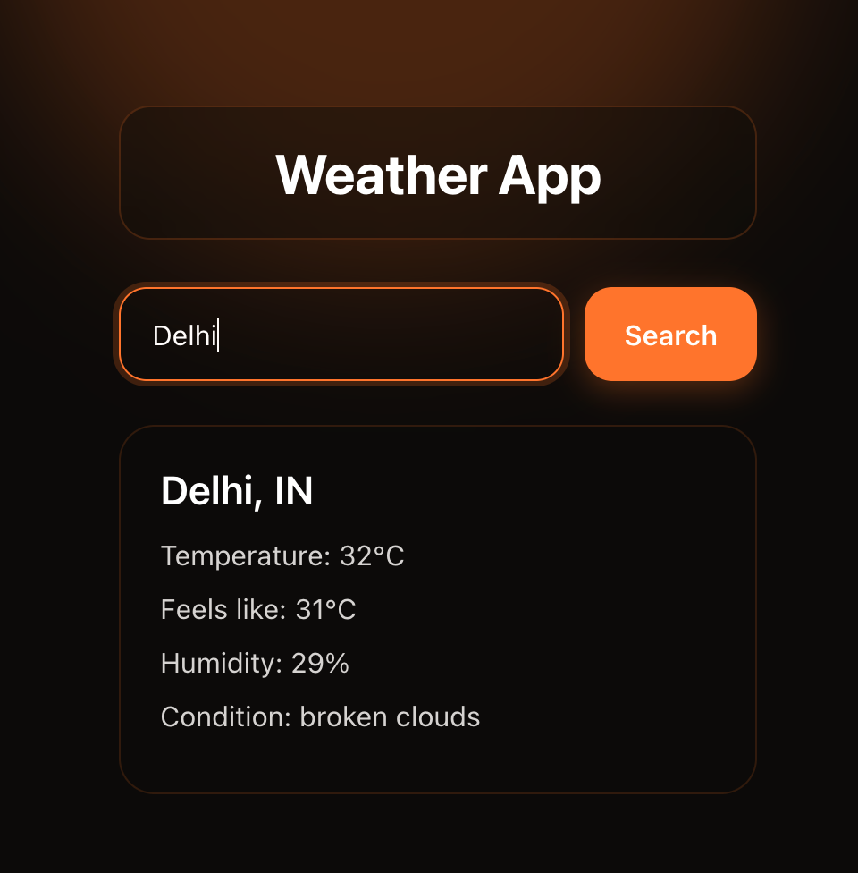

# 🌤️ Minimalist Weather App

A sleek, modern weather application built with React and powered by the OpenWeatherMap API. Features a minimalist glassmorphism interface with dark mode and orange-tinted accents.

---

## 📸 Screenshots

| Main Interface | Weather Result View |
| :---: | :---: |
|  |  |

---

## 🛠️ Tech Stack

- **Frontend:** React, Modern CSS3
- **API:** OpenWeatherMap API
- **Version Control:** Git & GitHub

---

## 🚀 Getting Started

### Prerequisites

Make sure you have Node.js installed on your system.

### Installation

1. **Clone the repository:**
   ```bash
   git clone [https://github.com/ashishxbhardwaj/weather-app.git](https://github.com/ashishxbhardwaj/weather-app.git)
   cd weather-app
